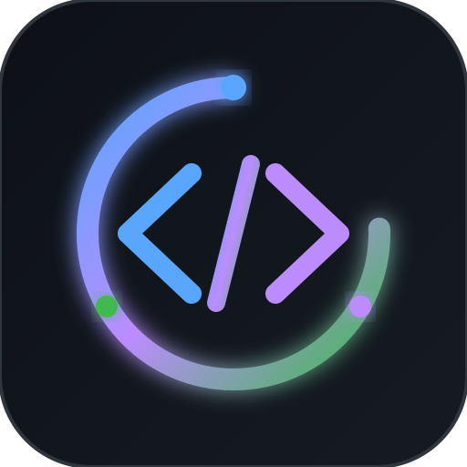

  

  # 🌐 OpenDevs Society

  ### *Empowering developers to build, collaborate, and innovate together.*

  

    <strong>🇹🇷 Türkiye merkezli, dünya standartlarında açık kaynak yazılımlar ve araçlar üreten geliştirici kolektifi.</strong> 
    <em>A Turkey-rooted open-source developer collective crafting next-generation software, tools, and smart systems for the world.</em>
  

  

    
    
    
    
  

---

### 🌟 Amiral Gemisi Projemiz / Flagship Project

  <table width="100%">
    <tr>
      <td align="center" style="padding: 20px;">
        <h3>🏠 <a href="https://github.com/OpenDevs-Society/NEXUS">NEXUS — Local-First Smart Home</a></h3>
        
<em>Buluta ve hub'a ihtiyaç duymadan, doğrudan yerel ağda çalışan, yapay zekâ destekli akıllı ev yönetim ekosistemi.</em>

        
<strong>Platformlar:</strong> Windows · Linux · macOS · Android · iOS

        

          
        

      </td>
    </tr>
  </table>

---

### 🇹🇷 Biz Kimiz? (Topluluk Felsefemiz)

**OpenDevs Society**, arkadaş grubu olarak çıktığımız bu yolda; birlikte öğrenmek, birlikte üretmek ve Türkiye'den dünyaya açık kaynak projeler sunmak amacıyla kurduğumuz bağımsız bir yazılımcı topluluğudur.

* 🤝 **Birlikte Üretim:** Ekip arkadaşlarımızla el ele verip uçtan uca mimariler, mobil/masaüstü uygulamalar ve yapay zekâ araçları inşa ediyoruz.
* 🔒 **Güvenli & Bağımsız Çalışma:** Toplulukta her proje bağımsızdır; kimse izinsiz başka bir üyenin projesine müdahale edemez. Projelerin mülkiyeti ve yönetim hakları onu geliştiren ekipte kalır.
* 🌍 **Global Vizyon:** Projelerimizi yerli bir ruhla üretirken, tüm dünyanın rahatça kullanabilmesi ve katkı sunabilmesi için uluslararası açık kaynak standartlarında belgelendiriyoruz.

---

### 🌐 About OpenDevs Society

**OpenDevs Society** is an independent collective of passionate software engineers and creators. We build robust, privacy-first, and high-performance open-source systems ranging from smart IoT architectures to developer productivity tooling.

> *"Great software is built by people who love building together."*

---

### 🎯 Odak Alanlarımız / Focus Areas

<table>
  <tr>
    <td width="50%" valign="top">
      <h4>⚡ Akıllı Sistemler & Otomasyon</h4>
      
Cihazlar arası doğrudan iletişimi sağlayan, yerel öncelikli (local-first) IoT ve otomasyon sistemleri.

    </td>
    <td width="50%" valign="top">
      <h4>🛠️ Geliştirici Altyapısı</h4>
      
Yazılımcıların işini kolaylaştıran modern CLI araçları, API kütüphaneleri ve entegrasyonlar.

    </td>
  </tr>
  <tr>
    <td width="50%" valign="top">
      <h4>🌐 Modern Web & Masaüstü</h4>
      
Electron, Capacitor ve modern frontend framework'leriyle geliştirilen yüksek performanslı platformlar.

    </td>
    <td width="50%" valign="top">
      <h4>🤖 Yapay Zekâ & Ajanlar</h4>
      
Yerel çalışan LLM entegrasyonları, Model Context Protocol (MCP) araçları ve akıllı asistanlar.

    </td>
  </tr>
</table>

---

### 🛠️ Kullandığımız Teknolojiler / Core Stack

  

---

### 👥 Çekirdek Ekip / Core Team

<table align="center">
  <tr>
    <td align="center" width="220">
      <a href="https://github.com/Enard52">
         
        <b>Ensar (Enard)</b>
      </a> 
      Kurucu & Core Developer
    </td>
    <td align="center" width="220">
      <a href="https://github.com/hadesonline02">
         
        <b>Eray (Hades)</b>
      </a> 
      Kurucu & Core Developer
    </td>
    <td align="center" width="220">
      <a href="https://github.com/OpenDevs-Society">
         
        <b>Aramıza Katılacak Arkadaşlar</b>
      </a> 
      Topluluk Katılımcıları
    </td>
  </tr>
</table>

---

### 🛡️ Topluluk İlkeleri & İzin Düzeni

1. **İzinsiz Değişiklik Yapılamaz:** Topluluğa üye olmak, projelere doğrudan müdahale hakkı tanımaz. Bir depoda değişiklik yapabilmek için ilgili projenin geliştiricisi tarafından açıkça "Yazma (Write)" izni verilmesi zorunludur.
2. **Özgür Mülkiyet:** Birlikte ürettiğimiz projeler topluluk çatısı altında gururla sergilenir, ancak her ekibin projesi kendi kontrolündedir.
3. **Katkı & Gelişim:** Yeni fikirleri ve projeleri olan arkadaşlarımız topluluk üzerinden yeni ortaklıklar kurabilir.

  Built with ❤️ by <b>OpenDevs Society</b>

